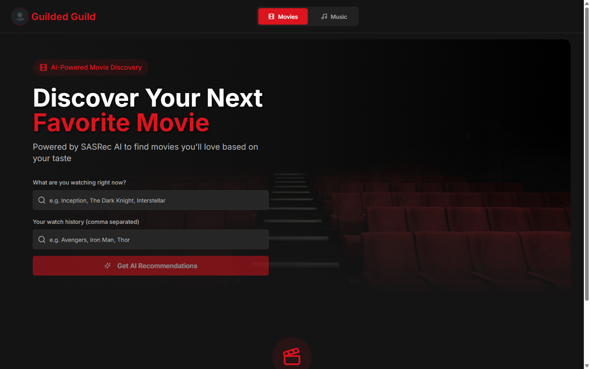

<div align="center">

# 🎬 AI-Based Content Recommendation System
### Sequential Deep-Learning Recommendations for Movies & Music

<em>Self-attentive sequential modelling (SASRec) served end-to-end through a Flask REST API and a React + TypeScript interface.</em>

<br/>

[](https://www.python.org/)
[](https://pytorch.org/)
[](https://flask.palletsprojects.com/)
[](https://react.dev/)
[](https://www.typescriptlang.org/)
[](https://vitejs.dev/)
[](LICENSE)

**[Overview](#-overview) • [Results](#-results) • [Architecture](#-architecture) • [Quick Start](#-quick-start) • [API](#-api-reference)**

[Project write-up](https://www.divyakush.com/projects/content-recommendation-engine) · [Report a bug](https://github.com/Divyakush2006/Guilded-Guild/issues/new/choose) · [Request a feature](https://github.com/Divyakush2006/Guilded-Guild/issues/new/choose)



</div>

---

## 📖 Overview

A production-oriented recommendation engine that predicts what a user will engage with **next**, by modelling the *sequence* of their interactions rather than treating them as an unordered set. Built on the **MovieLens 20M** dataset (27,278 movies · 20M+ ratings · 138,493 users) and extended to music via live Spotify/iTunes catalog data.

Unlike classical collaborative filtering, this system uses a **Self-Attentive Sequential Recommendation (SASRec)** transformer to capture temporal preference patterns — directly addressing the **cold-start** and **sequential-understanding** limitations of matrix-factorisation approaches.

| | |
|---|---|
| 🧠 **Model** | SASRec (self-attention) + NCF baseline, implemented from scratch in PyTorch |
| 🎯 **Domain** | Cross-domain — movies (MovieLens 20M) **and** music (Spotify / iTunes) |
| 🖥️ **Serving** | Flask REST API with CORS + a React 18 / TypeScript / Vite SPA |
| 🖼️ **Enrichment** | TMDB posters & trailers (100% fetch-success rate), Spotify metadata |

---

## 📊 Results

Evaluated on a held-out temporal split of MovieLens 20M (leave-last-out protocol):

| Metric | Score |
|--------|-------|
| **AUC-ROC** | **98.47%** |
| **Hit-Rate @ 10** | **98.23%** |
| Model parameters | ~25M |
| Poster/trailer enrichment success (TMDB) | 100% |

> Metrics are reproducible via `flask_app/evaluate_sasrec.py` on the provided data split.

---

## 🏗️ Architecture

```
┌──────────────────────────┐        ┌───────────────────────────────┐
│  React + TS Frontend      │  REST  │  Flask API  (flask_app/app.py) │
│  (harmony-hub / Vite)     │ <────> │  /api/recommend/movies         │
│  shadcn-ui · Tailwind     │  JSON  │  /api/recommend/music          │
└──────────────────────────┘        └───────────────┬───────────────┘
                                                     │
                            ┌────────────────────────┼────────────────────────┐
                            ▼                        ▼                         ▼
                  ┌──────────────────┐   ┌────────────────────┐   ┌────────────────────┐
                  │  SASRec (PyTorch) │   │  Enrichment Layer  │   │  Music Pipeline     │
                  │  self-attention   │   │  TMDB posters/     │   │  Spotify + iTunes   │
                  │  + NCF baseline   │   │  trailers          │   │  fetch + sequence   │
                  └──────────────────┘   └────────────────────┘   └────────────────────┘
```

### 🔬 Model internals (`flask_app/sasrec_model.py`)
- **Item + positional embeddings** with padding-aware masking
- **Multi-head self-attention** blocks with pre-LayerNorm residual connections
- **Point-wise feed-forward** networks (`Conv1d`, kernel size 1) with dropout regularisation
- Trained with `train_sasrec.py`; evaluated with `evaluate_sasrec.py`; **NCF** (`train_ncf.py`) retained as a baseline for comparison

---

## 🧰 Tech Stack

| Layer | Technologies |
|-------|-------------|
| **Modelling** | PyTorch · SASRec · Neural Collaborative Filtering · NumPy · Pandas |
| **Backend** | Flask · Flask-CORS · REST · Python 3.13 |
| **Frontend** | React 18 · TypeScript · Vite · shadcn/ui · Radix UI · Tailwind CSS · Vitest |
| **Data & APIs** | MovieLens 20M · Spotify API · iTunes API · TMDB API |

---

## 🚀 Quick Start

### Prerequisites
- Python 3.11+ and Node.js 18+
- The [MovieLens 20M](https://grouplens.org/datasets/movielens/20m/) dataset: place `ratings.csv` and `movies.csv` in the repository root
- Optional: a [TMDB API key](https://www.themoviedb.org/settings/api) for posters and trailers, and [Spotify credentials](https://developer.spotify.com/dashboard) for music recommendations. Without them the app still runs, with enrichment and music turned off.

> [!NOTE]
> The dataset, processed sequences and trained weights are not committed because of their size. Build them once (step 1); the API loads `flask_app/sasrec_epoch_20.pth` at start-up.

### 1 — Backend (Flask + model)
```bash
git clone https://github.com/Divyakush2006/Guilded-Guild.git
cd Guilded-Guild/flask_app

python -m venv venv && source venv/bin/activate   # Windows: venv\Scripts\activate
pip install torch flask flask-cors pandas numpy requests python-dotenv spotipy scikit-learn tqdm

cp ../.env.example .env        # fill in TMDB_API_KEY and, optionally, the Spotify keys

# First run only: build training sequences, then train SASRec
python data_sequencer.py       # writes processed_sequences.pkl and item_encoder.pkl
python train_sasrec.py         # writes sasrec_epoch_20.pth

python app.py                  # API and legacy HTML pages at http://localhost:5000
```

`data_sequencer.py` reads `../ml-25m/ratings.csv` by default. If your ratings file is elsewhere (for example `../ratings.csv`), update the path in the `__main__` block at the bottom of the script.

### 2 — Frontend (React + Vite)
```bash
cd ../harmony-hub-main
npm install
npm run dev                    # http://localhost:8080, with /api proxied to Flask on :5000
```

### 3 — (Optional) Evaluate the model
```bash
cd ../flask_app
python evaluate_sasrec.py      # reproduce AUC-ROC / Hit-Rate@10
```

---

## 📡 API Reference

| Method | Endpoint | Body | Description |
|--------|----------|------|-------------|
| `POST` | `/api/recommend/movies` | `{ "current_watch": str, "history": [str] }` | Sequential movie recommendations with TMDB enrichment |
| `POST` | `/api/recommend/music`  | `{ "current_track": str, "history": [str] }` | Music recommendations via Spotify/iTunes pipeline |
| `GET`  | `/` · `/music` | — | Server-rendered legacy demo pages |

<details>
<summary><b>Example request</b></summary>

```bash
curl -X POST http://localhost:5000/api/recommend/movies \
  -H "Content-Type: application/json" \
  -d '{"current_watch": "Inception", "history": ["The Matrix", "Interstellar"]}'
```
</details>

---

## 📁 Project Structure

```
Guilded-Guild/
├── flask_app/
│   ├── app.py                 # Flask REST API + CORS
│   ├── sasrec_model.py        # SASRec transformer (PyTorch)
│   ├── train_sasrec.py        # training loop
│   ├── evaluate_sasrec.py     # metrics: AUC-ROC / Hit-Rate@10
│   ├── train_ncf.py           # NCF baseline
│   ├── inference*.py          # movie + music inference
│   ├── tmdb_fetcher.py        # poster/trailer enrichment
│   ├── spotify_fetcher.py     # music catalog integration
│   └── templates/             # legacy server-rendered UI
├── harmony-hub-main/          # React 18 + TS + Vite frontend
└── AI_Content_Recommendation_Submission.ipynb
```

---

## 🗺️ Roadmap
- [ ] Containerise backend + model with Docker for one-command deploy
- [ ] Add Redis caching layer for hot recommendations
- [ ] Expose model-explainability (attention weights) in the UI

---

## 🤝 Contributing

Contributions are welcome. Please read the [contributing guide](https://github.com/Divyakush2006/.github/blob/main/CONTRIBUTING.md) before opening a pull request.

## 🔒 Security

Please report vulnerabilities privately as described in the [security policy](https://github.com/Divyakush2006/.github/blob/main/SECURITY.md). Do not open a public issue.

## 📄 License

Released under the [MIT License](LICENSE).

---

## 👤 Author

**Divyakush Punjabi** — B.Tech CSE @ VIT Vellore · AI Major @ IIT Ropar
[](https://linkedin.com/in/divyakush-punjabi)
[](https://www.divyakush.com)
[](https://github.com/divyakush2006)

<div align="center"><sub>⭐ If this project helped or impressed you, consider starring the repo.</sub></div>
